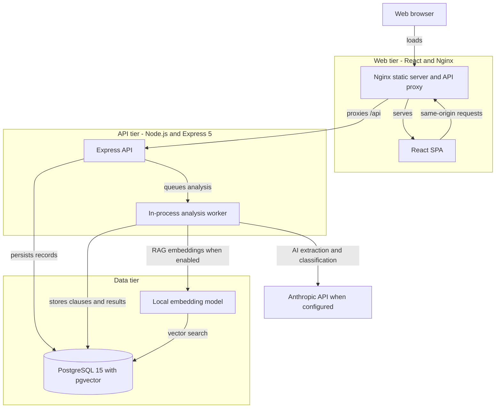
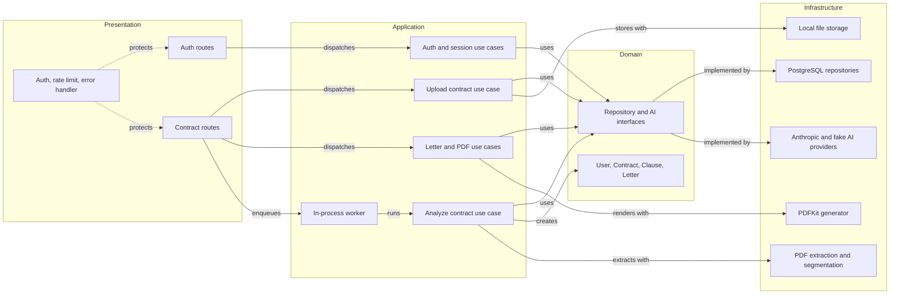

# Architecture Diagram

This document summarizes the deployed runtime boundaries and the most important component dependencies in the existing ContratoClaro application.

## Application Architecture

<!-- mermaid-checked: no \n, no em-dash/en-dash, no {} in labels, subgraphs are id["label"], arrows are -->|"label"|, all subgraphs closed by end, ids unique -->

### Technology Stack Summary

| Layer | Technology | Version | Purpose |
|---|---|---:|---|
| Web | React, TypeScript, Vite | React 19, Vite 8 | Bilingual responsive SPA |
| Web serving | Nginx | Alpine image | Static assets and same-origin API reverse proxy |
| API | Node.js, Express | Node 22, Express 5 | Authenticated versioned API and in-process worker |
| Persistence | PostgreSQL with pgvector | PostgreSQL 15 | Accounts, contracts, clauses, letters, usage, optional legal vectors |
| AI | Anthropic SDK or FakeAIProvider | SDK version in backend package manifest | Document transcription, classification, letters, offline demo |
| PDF | PDFKit | Version in backend package manifest | Localized objection-letter PDF |
| CI | GitHub Actions | Node 22 | Type-check, tests, evaluation, lint, build, browser tests |

### Data Storage & External Services

PostgreSQL stores user records, extracted contract clauses, analysis results,
letters, AI usage, and optional legal provisions. pgvector is required by the
migration set. The browser reaches the API through Nginx on the same origin.
Anthropic is an optional external service in development and is required by
production configuration; RAG uses a local embedding model and PostgreSQL
vector search. Original uploads are configured for ephemeral handling by
default. Production file retention is deliberately rejected until a private,
encrypted object-storage adapter and lifecycle policy exist.

### Key Architectural Decisions

- Clean layers separate Express presentation, application use cases, domain
  entities, and infrastructure adapters; repositories and AI providers are
  consumed through interfaces.
- Analysis is asynchronous to the upload response but runs in a bounded
  in-process worker. The backend must remain at one replica until jobs are
  durable across restarts and replicas.
- Docker Compose is for local demonstration and validation. Production requires
  an external TLS ingress, managed PostgreSQL with backups, secret management,
  and a single backend replica.

## Component Relationships

<!-- mermaid-checked: no \n, no em-dash/en-dash, no {} in labels, subgraphs are id["label"], arrows are -->|"label"|, all subgraphs closed by end, ids unique -->

### Component Inventory

| Component | Layer | Type | Responsibility |
|---|---|---|---|
| `authRoutes.ts` | Presentation | Express router | Registration, login, refresh, logout, profile, account deletion |
| `contractRoutes.ts` | Presentation | Express router | Upload, list, result, status, delete, letter, and PDF endpoints |
| Auth middleware and limiters | Presentation | Middleware | Access-token checks and per-IP/per-user request limits |
| Auth and session use cases | Application | Use cases | Register, authenticate, refresh, and delete account data |
| Upload contract use case | Application | Use case | Validate upload, apply retention adapter, and create contract |
| Analyze contract use case | Application | Pipeline use case | Extract, segment, retrieve optional legal context, classify, and persist |
| Letter use cases | Application | Use cases | Generate, update, and render persisted objection letters |
| In-process analysis worker | Application | Bounded worker | Schedules analysis jobs within one backend process |
| Domain entities and interfaces | Domain | Entities and ports | Lifecycle, risk score, value rules, and adapter contracts |
| PostgreSQL repositories | Infrastructure | Persistence adapters | Map records to domain entities and persist changes |
| AI providers | Infrastructure | Strategy adapters | Anthropic-backed behavior or deterministic offline behavior |
| PDF and file services | Infrastructure | Service adapters | Extract PDF text, segment clauses, store uploads, and render PDFs |
