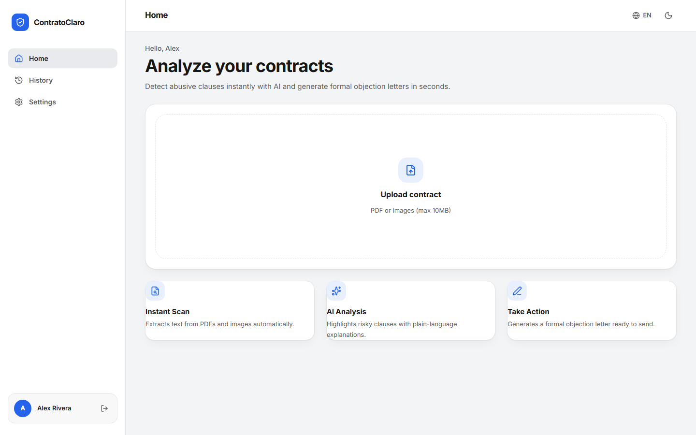
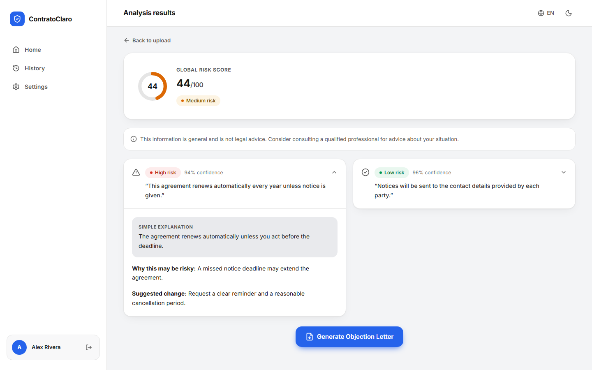
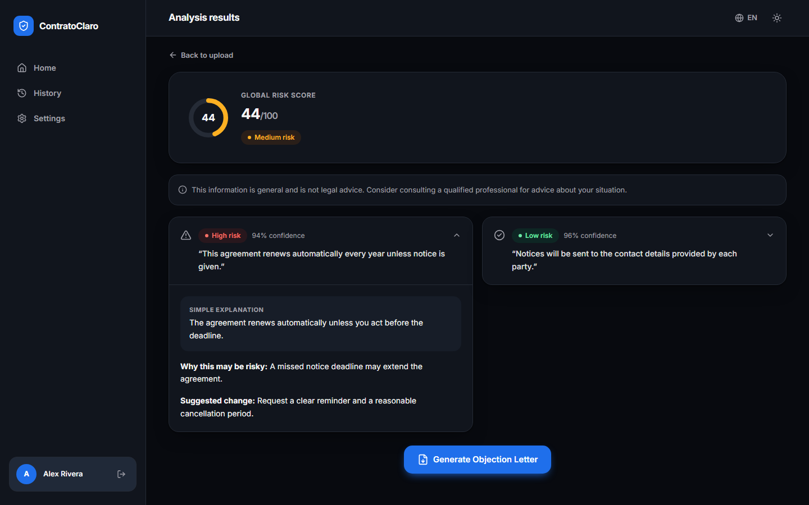
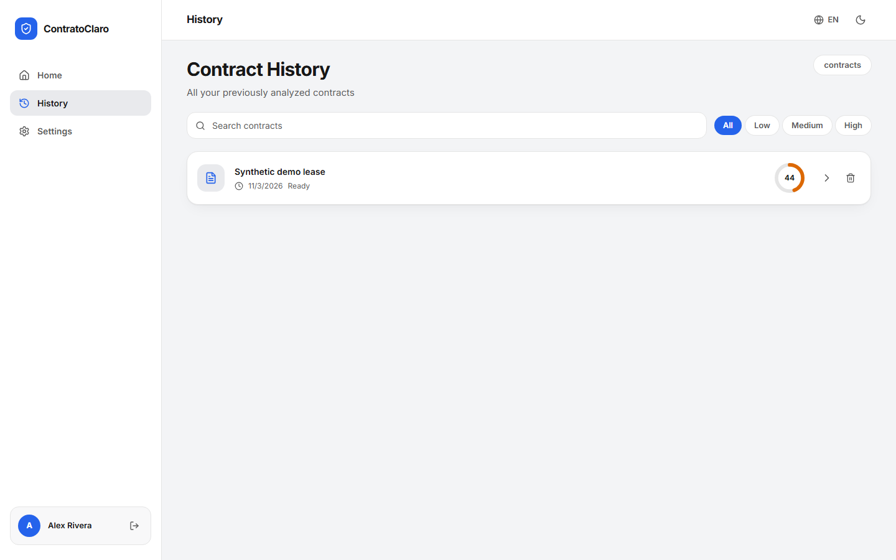
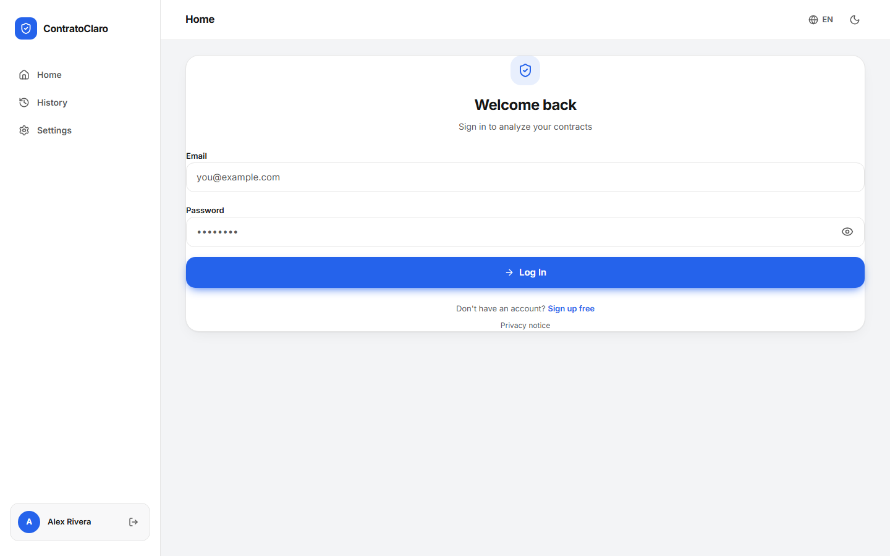
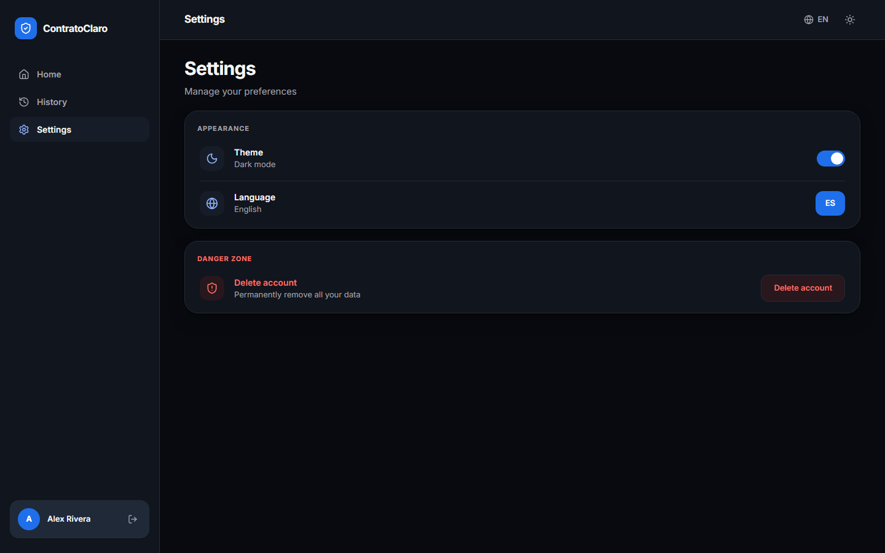
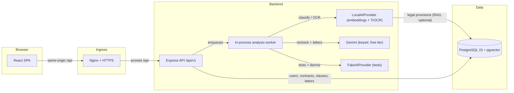

# ContratoClaro — Backend

> Este repo es solo el **backend** (API Express + worker + DB).
> Frontend separado en: https://github.com/Jesusdavid2004/Contrato_cero_fronent

ContratoClaro helps tenants, consumers, and employees understand risky terms
in contracts and prepare a respectful objection letter. It provides general
information, **not legal advice**.

> **Live demo:** no public deployment exists yet. Provision the stack below
> locally, or deploy with [the Render blueprint](./render.yaml) and publish the
> URL here as `https://contratoclaro.example.com`.

## Screenshots

Synthetic demo data, English, light theme unless noted.

| Home (upload + product modules) | Analysis results (risk score + clauses) |
|---|---|
|  |  |

| Analysis results (dark theme) | Contract history |
|---|---|
|  |  |

| Login | Settings (dark theme) |
|---|---|
|  |  |

## Architecture



See [full architecture and Mermaid diagrams](./docs/architecture.md).

## Quick Start

Requirements: Docker Engine with Compose v2. Node.js 22 is required to run the
repository checks outside the containers.

```powershell
Copy-Item .env.example .env
notepad .env
docker compose up --build -d
docker compose ps
docker compose exec -e SEED_DEMO=true backend node dist/scripts/seed-demo.js
```

1. Copy the environment template: `Copy-Item .env.example .env`.
2. Edit `.env`: set `DB_PASSWORD`, `JWT_SECRET`, and
   `DEMO_USER_PASSWORD` (at least 12 characters). For hybrid AI, also set
   `GEMINI_API_KEY` (free tier) or nothing at all. These values are for
   local development only.
3. Build and start PostgreSQL, backend, and frontend:
   `docker compose up --build -d`.
4. Wait until the services are healthy (`docker compose ps`), then create
   synthetic demo data:
   `docker compose exec -e SEED_DEMO=true backend node dist/scripts/seed-demo.js`.
5. Open `http://localhost:8080` and sign in with the demo credentials from
   `.env`.

The demo seed is development-only, idempotent, and does not create or store an
original contract file. See [the live demo script](./docs/demo-script.md).

## Features

- Register and sign in; upload PDF, PNG, JPEG, WebP, TIFF, BMP, or GIF contract documents (max 10 MB, validated by magic bytes).
- Track asynchronous analysis stages (extracting → segmenting → classifying) and inspect ordered clauses with low, medium, or high risk explanations.
- Generate and edit a letter based on medium/high-risk clauses; download it as
  a localized PDF.
- View contract history, delete a contract, and permanently delete an account.
- Switch English/Spanish and light/dark themes (persisted, no flash on load).
- Optional Colombian legal-context retrieval with pgvector; it is disabled by
  default and is not a substitute for checking official legal sources.
  Verified citations link to official sources with tema badge and date; see
  the in-app Coverage page (`/coverage`, 20 curated provisions).

## Architecture and Documentation

- [Architecture and Mermaid diagrams](./docs/architecture.md)
- [Deployment guide and current deployment status](./docs/deployment.md)
- [API overview](./docs/api.md) and [OpenAPI 3.1 contract](./docs/openapi.yaml)
- [Security notes and production blockers](./docs/security.md)
- [Demo walkthrough](./docs/demo-script.md)
- [Offline evaluation and limitations](./docs/evaluation.md)
- [Runtime validation evidence](./docs/runtime-validation-report.md)
- [Architecture discovery diagrams](./.github/modernize/assessment/engines/facts/architecture-diagram.md)
- [Architecture decision records](./docs/adr/)
- [Changelog](./CHANGELOG.md)

There is **no public HTTPS deployment URL yet** — see [Live demo](#live-demo)
above. Until then, a cloud provider, authorized account/subscription, domain,
managed database, and secret store must be chosen before provisioning
production infrastructure. Local Compose is not a production deployment.

## Technology Stack

| Area | Technology |
|---|---|
| Frontend | React 19, TypeScript, Vite, Tailwind CSS 4, i18next |
| Backend | Node.js 22, Express 5, TypeScript |
| Database | PostgreSQL 15 with pgvector |
| AI | Local neural provider by default (multilingual embeddings + on-device TrOCR, zero APIs); hybrid free Gemini tier for low-confidence rechecks and letters when a key is set; deterministic FakeAIProvider for tests only |
| PDF | PDFKit |
| Tests | Vitest, Testing Library, Supertest, Playwright (mocked + real-backend e2e), axe-core, Lighthouse |
| Quality | axe-core 0 violations (both themes), Lighthouse reports in docs/quality |
| Containers and CI | Docker Compose, GitHub Actions |

## Configuration

Docker Compose reads the root `.env`; the backend reference is
[backend/.env.example](./backend/.env.example). Never commit `.env` files or
put real contract data or production credentials into the demo environment.

| Variable | Purpose | Local default |
|---|---|---|
| `DB_PASSWORD` | PostgreSQL password | Local-only sample; replace before use |
| `JWT_SECRET` | Signs access and refresh tokens | Local-only sample; replace before use |
| `CORS_ORIGIN` | Exact browser origin allowed by the backend | `http://localhost:8080` |
| `NODE_ENV` | Runtime mode | `development` |
| `AI_PROVIDER` | `gemini`, `local` or `fake` (empty = auto) | `local` |
| `GEMINI_API_KEY` | Free-tier hosted refiner + letter writer ([AI Studio](https://aistudio.google.com/apikey)) | Empty; local model does everything |
| `RAG_ENABLED` | Enable legal provision retrieval | `false` |
| `CONTRACT_FILE_RETENTION` | Original upload retention | `none` |
| `DEMO_USER_EMAIL` | Local synthetic demo account | `demo@example.test` |
| `DEMO_USER_PASSWORD` | Local demo password; at least 12 characters | Must be set |

Production works without any API key by using the local neural
provider (multilingual embeddings + local TrOCR); models download once into
`EMBEDDING_CACHE_DIR` and then run offline. The deterministic
`FakeAIProvider` is a test-only double, rejected at production startup.

## Validation Commands

From `backend/`:

```powershell
npm ci
npm run type-check
npm test
npm run build
npm run evaluate
```

From `frontend/`:

```powershell
npm ci
npm test
npm run lint
npm run type-check
npm run i18n:check
npm run build
npm run test:e2e
```

Playwright browser tests stub the API for deterministic UI coverage. Backend
integration tests and the PostgreSQL-backed demo seed provide separate API and
database evidence; see the runtime report for exact scope and gaps.

## Screenshots and quality evidence

See [Screenshots](#screenshots) above and the [quality reports](./docs/quality/)
(axe-core: 0 violations in both themes; Lighthouse desktop reports).

## Resumen en español

ContratoClaro ayuda a revisar contratos, entender cláusulas de riesgo y preparar
una carta de objeción editable. La información es general y no constituye
asesoría legal. La demo local usa datos sintéticos; todavía no existe un
despliegue público HTTPS.
