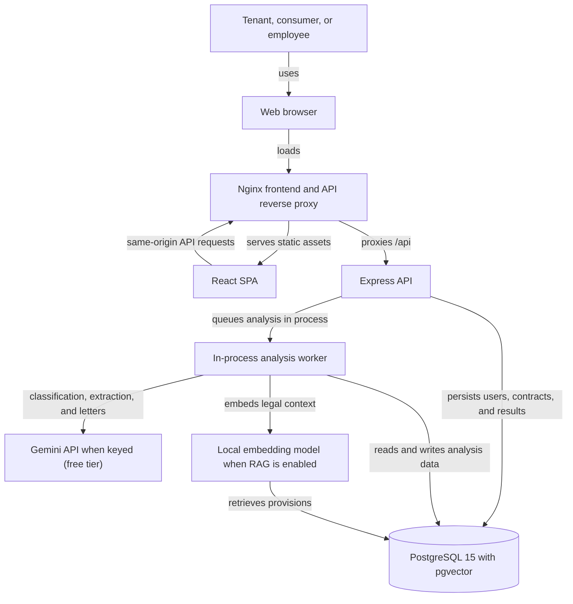
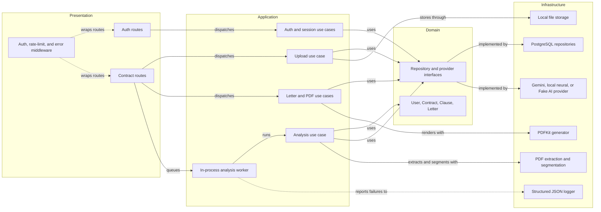
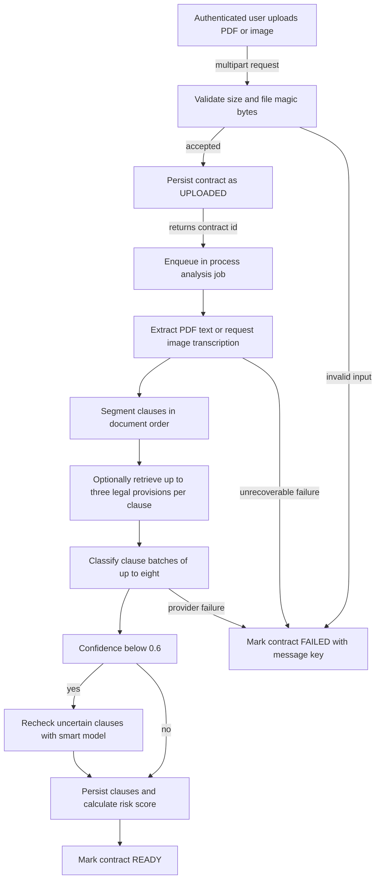
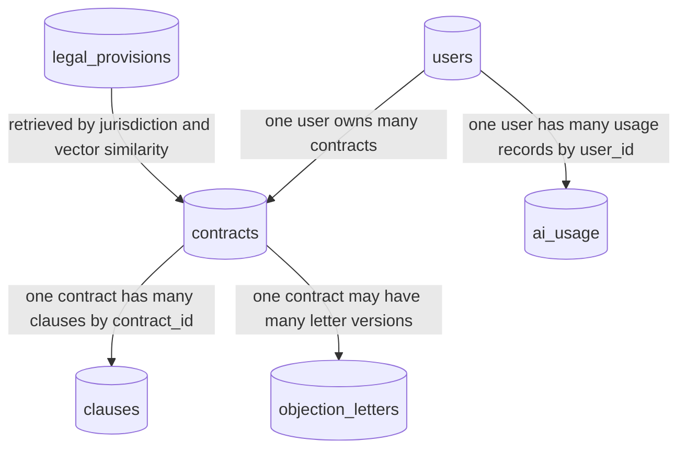
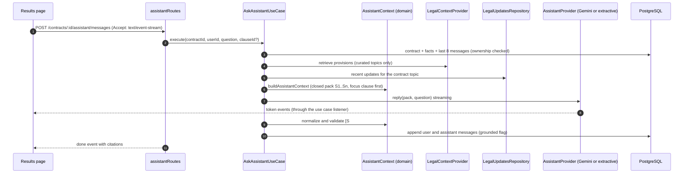
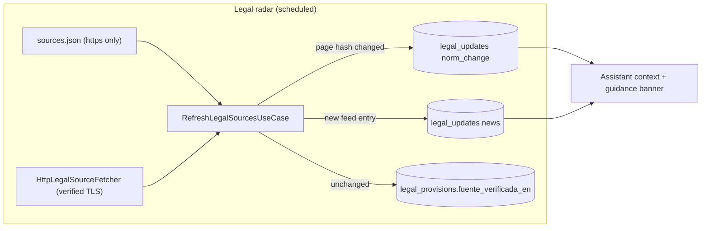

# ContratoClaro Architecture

ContratoClaro is a bilingual React SPA backed by an Express API and PostgreSQL. Contract analysis is queued in-process; the API persists extracted clauses and risk results, and generates objection letters from flagged clauses.

## System Context

<!-- mermaid-checked: no \n, no em-dash/en-dash, no {} in labels, subgraphs are id["label"], arrows are -->|"label"|, all subgraphs closed by end, ids unique -->

### Deployment Context

The local Docker Compose topology contains a PostgreSQL/pgvector database, the
Express backend, and an Nginx-served React frontend. The frontend proxies API
traffic on the same origin. A production installation must place a TLS-enabled
reverse proxy or managed ingress in front of the frontend and keep the database
and backend off the public network.

## Component Relationships

<!-- mermaid-checked: no \n, no em-dash/en-dash, no {} in labels, subgraphs are id["label"], arrows are -->|"label"|, all subgraphs closed by end, ids unique -->

### Main AI Analysis Flow

<!-- mermaid-checked: no \n, no em-dash/en-dash, no {} in labels, subgraphs are id["label"], arrows are -->|"label"|, all subgraphs closed by end, ids unique -->

### Entity Relationship Diagram

<!-- mermaid-checked: no \n, no em-dash/en-dash, no {} in labels, subgraphs are id["label"], arrows are -->|"label"|, all subgraphs closed by end, ids unique -->

The data relationship diagram is intentionally a flowchart rather than a
crow-foot ER notation so that entity ownership and foreign-key direction remain
readable in GitHub's Mermaid renderer.

## Contract assistant, narration and legal radar

Three features sit on top of the analysis: a grounded **assistant** (chat per
contract), a spoken **walkthrough** (plan + narration) and a **legal radar**
that watches official sources. See
[ADR 0009](adr/0009-contract-assistant-and-legal-radar.md).

New tables: `assistant_messages` (cascade-deleted with the contract),
`legal_updates` (unique per source and content hash) and `legal_source_state`
(last hash and check time per source).

Design rules worth remembering:

- Priorities, ordering and deadlines of the action plan are computed in
  `domain/services/ActionPlan.ts`; the LLM never produces numbers or decisions.
  Plan steps and narration segments carry message keys, so the frontend
  translates them and the narration follows a runtime language switch.
- The assistant may only cite sources in its context pack. Press items are
  labeled as unofficial and are never presented as law.
- A radar failure never breaks analysis or chat: each source is isolated and a
  missing catalog only disables the radar.

## Architectural Boundaries and Limits

- Presentation routes validate HTTP input and dispatch use cases; application
  use cases own orchestration and authorization; domain entities own risk
  scoring and lifecycle rules; infrastructure contains PostgreSQL, AI,
  extraction, storage, and PDF adapters.
- Repository and AI interfaces keep application logic independent of concrete
  PostgreSQL and AI implementations. The default is hybrid: `LocalAIProvider`
  (multilingual embeddings + local TrOCR, zero external APIs) classifies every
  clause, and the free Gemini adapter rechecks uncertain clauses and writes
  letters when `GEMINI_API_KEY` is set via
  `TieredAIProvider`. Set `AI_PROVIDER` to force a single provider;
  `FakeAIProvider` is the deterministic test double.
- The worker and classification cache are process-local. Run exactly one
  backend replica until work is moved to a durable queue and shared cache.
- Production startup rejects the deterministic demo provider and non-ephemeral
  contract retention. Encrypted private object storage is not implemented yet.
