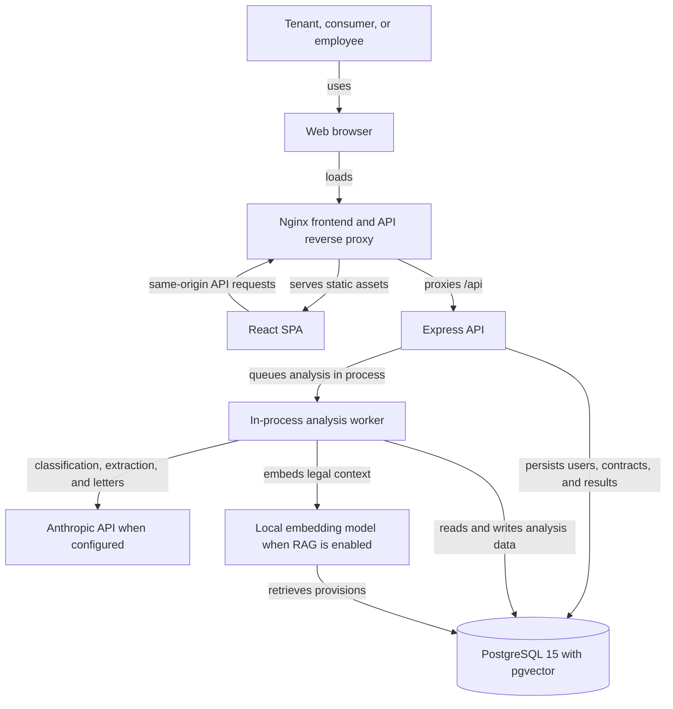
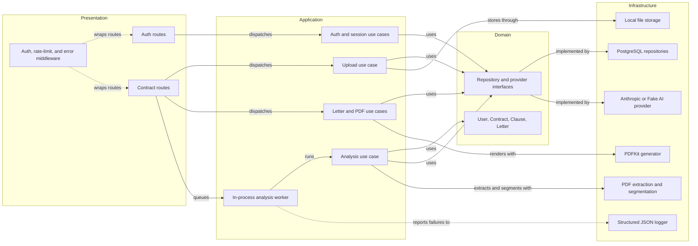
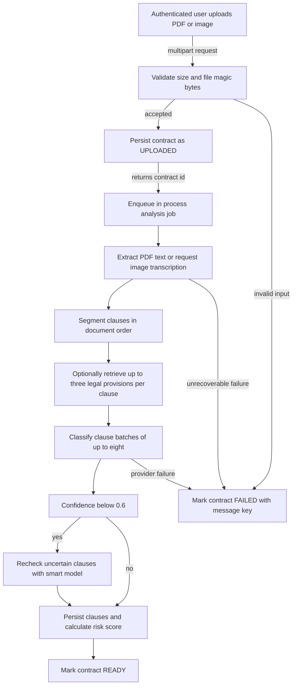
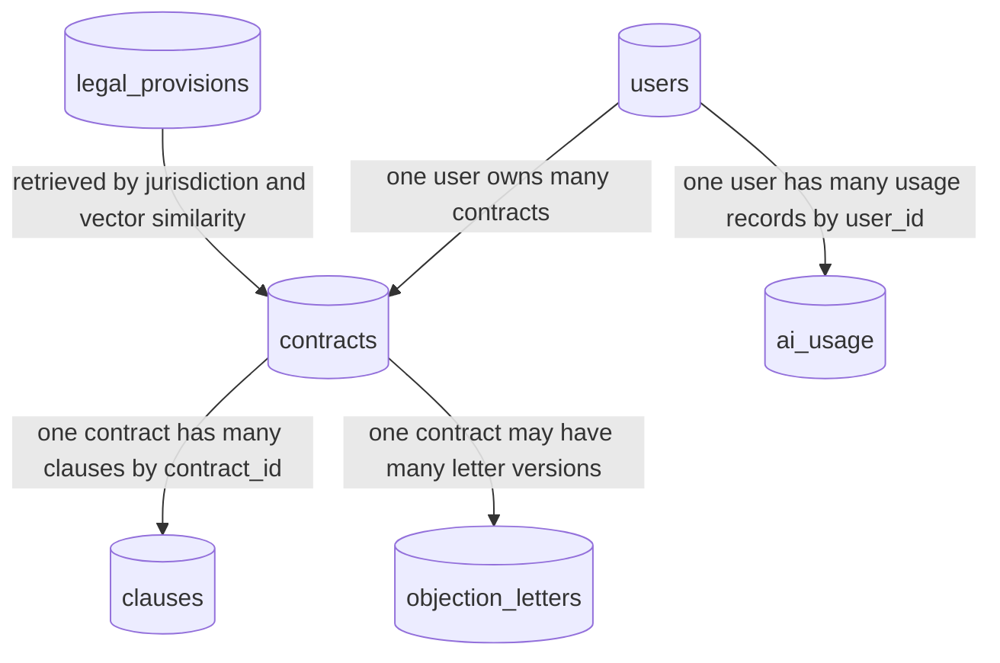

# ContratoClaro Architecture

ContratoClaro is a bilingual React SPA backed by an Express API and PostgreSQL. Contract analysis is queued in-process; the API persists extracted clauses and risk results, and generates objection letters from flagged clauses.

## System Context

<!-- mermaid-checked: no \n, no em-dash/en-dash, no {} in labels, subgraphs are id["label"], arrows are -->|"label"|, all subgraphs closed by end, ids unique -->

### Deployment Context

The local Docker Compose topology contains a PostgreSQL/pgvector database, the
Express backend, and an Nginx-served React frontend. The frontend proxies API
traffic on the same origin. A production installation must place a TLS-enabled
reverse proxy or managed ingress in front of the frontend and keep the database
and backend off the public network.

## Component Relationships

<!-- mermaid-checked: no \n, no em-dash/en-dash, no {} in labels, subgraphs are id["label"], arrows are -->|"label"|, all subgraphs closed by end, ids unique -->

### Main AI Analysis Flow

<!-- mermaid-checked: no \n, no em-dash/en-dash, no {} in labels, subgraphs are id["label"], arrows are -->|"label"|, all subgraphs closed by end, ids unique -->

### Entity Relationship Diagram

<!-- mermaid-checked: no \n, no em-dash/en-dash, no {} in labels, subgraphs are id["label"], arrows are -->|"label"|, all subgraphs closed by end, ids unique -->

The data relationship diagram is intentionally a flowchart rather than a
crow-foot ER notation so that entity ownership and foreign-key direction remain
readable in GitHub's Mermaid renderer.

## Architectural Boundaries and Limits

- Presentation routes validate HTTP input and dispatch use cases; application
  use cases own orchestration and authorization; domain entities own risk
  scoring and lifecycle rules; infrastructure contains PostgreSQL, AI,
  extraction, storage, and PDF adapters.
- Repository and AI interfaces keep application logic independent of concrete
  PostgreSQL and Anthropic SDKs. `FakeAIProvider` supports deterministic demos.
- The worker and classification cache are process-local. Run exactly one
  backend replica until work is moved to a durable queue and shared cache.
- Production startup rejects the deterministic demo provider and non-ephemeral
  contract retention. Encrypted private object storage is not implemented yet.
