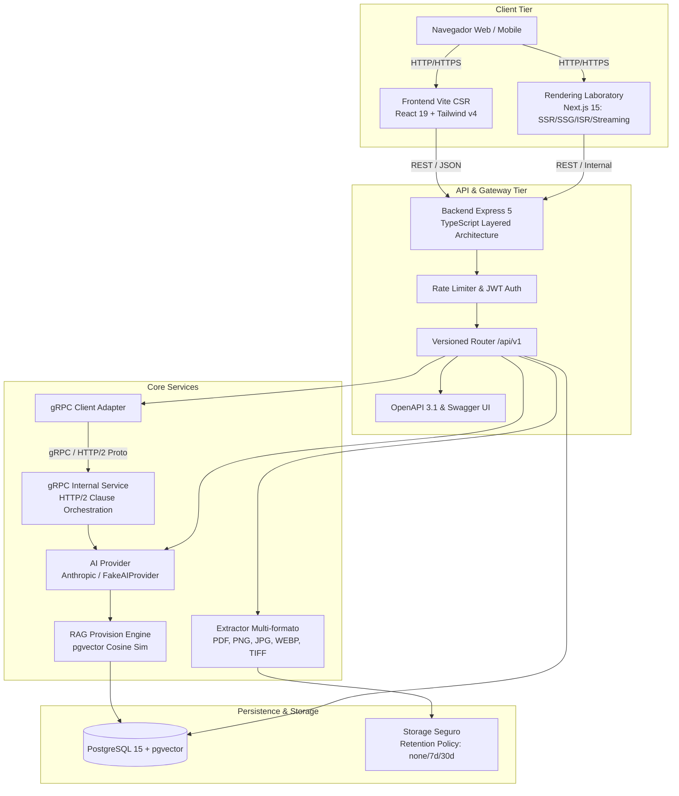
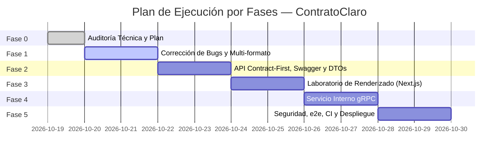

# CONTRATOCLARO — AUDITORÍA TÉCNICA INTEGRAL Y PLAN DE IMPLEMENTACIÓN (FASE 0)

**Fecha:** 2026-10-19  
**Estado:** Fase 0 — Auditoría de solo lectura aprobada para revisión  
**Autores:** Senior Full-Stack Engineer, Software Architect, Application Security Specialist & AI Integration Engineer  
**Repositorio:** `Jesusdavid2004/Contrato_ceroO`  
**Directiva de Fase 0:** Solo lectura. No se realizan modificaciones de código funcional hasta la aprobación explícita de este informe.

---

## 1. Resumen Ejecutivo y Estado General del Repositorio

ContratoClaro es una plataforma diseñada para empoderar a arrendatarios, trabajadores y consumidores mediante el análisis automatizado de contratos, la detección de cláusulas abusivas o desproporcionadas, la explicación en lenguaje claro y la generación de cartas de objeción formales.

El repositorio cuenta actualmente con una arquitectura dividida en:
1. **Frontend (`/frontend`):** Aplicación SPA construida sobre **React 19**, **Vite 8**, **Tailwind CSS 4**, **React Router 7**, **i18next**, **Framer Motion** y **Lucide Icons**. Funciona exclusivamente bajo renderizado del lado del cliente (**CSR**).
2. **Backend (`/backend`):** Servidor HTTP construido con **Express 5** sobre **Node.js** y **TypeScript**. Dispone de una arquitectura limpia en capas (`src/domain`, `src/application`, `src/infrastructure`, `src/presentation`), compatibilidad legacy con scripts históricos (`index.js`), base de datos **PostgreSQL 15** (con extensión `pgvector`), migración versionada (`node-pg-migrate`), y adaptadores para la API de **Anthropic** (Claude 3.5 Sonnet / Haiku) con fallback simulado (`FakeAIProvider`).

### Verificación de Estado en Frío (Línea Base)
- **Compilación Backend (`tsc -p tsconfig.build.json`):** ✅ Exitosa sin errores.
- **Type-Check Backend (`tsc --noEmit`):** ✅ Exitoso (0 errores).
- **Pruebas Backend (`vitest run`):** ✅ 11 suites, 88 pruebas unitarias y de integración pasando.
- **Lint Frontend (`oxlint`):** ⚠️ 0 errores, 1 advertencia Fast Refresh en `AuthContext.tsx` (`useAuth` exportado junto a `AuthProvider`).
- **Construcción Frontend (`vite build`):** ✅ Exitosa.
- **Type-Check Frontend (`tsc --noEmit`):** ❌ **Falla crítica**: `typescript` no está instalado en `frontend/package.json`, impidiendo la verificación estática de tipos en CI.

---

## 2. Auditoría de Arquitectura Existente

### 2.1 Frontend
- **Stack:** React 19.2.8, Vite 8.3.0, Tailwind CSS 4.3.3, React Router DOM 7.18.4, i18next 26.4.2.
- **Capacidades actuales:** Gestión de sesión de usuario, subida de documentos con drag-and-drop, visualización de resultados con desglose de riesgo por colores (verde, amarillo, rojo), resumen global ponderado, edición de carta de objeción y descarga en PDF.
- **Limitación arquitectónica:** Es 100% Client-Side Rendering (CSR). No posee capacidades de Server-Side Rendering (SSR), Static Site Generation (SSG), Incremental Static Regeneration (ISR) ni Streaming SSR con Suspense.

### 2.2 Backend
- **Stack:** Express 5.2.1, Node.js, TypeScript (compilado a CommonJS en `dist/`), PostgreSQL vía `pg 8.23.1`.
- **Estructura de Capas:**
  - `src/domain`: Entidades (`User`, `Contract`, `Clause`, `ObjectionLetter`), Value Objects (`RiskLevel`, `RiskScore`, `ContractType`), Excepciones de dominio e Interfaces de infraestructura.
  - `src/application`: Casos de uso desacoplados (`RegisterUser`, `Login`, `UploadContract`, `AnalyzeContract`, `GenerateObjectionLetter`, `DownloadObjectionLetterPdf`, `DeleteAccount`, `UpdateObjectionLetter`).
  - `src/infrastructure`: Repositorios PostgreSQL y en memoria, servicio de almacenamiento local (`LocalFileStorage`), extracción de texto (`PdfTextExtractor`), segmentador adaptativo de cláusulas (`AdaptiveClauseSegmenter`), cliente de Anthropic con batching y retry (`AnthropicAIProvider`), RAG legal con embeddings (`PostgresLegalContextProvider`).
  - `src/presentation`: Rutas de Express, middlewares de autenticación JWT y rate limiters (`express-rate-limit`).

### 2.3 Base de Datos y Persistencia
- PostgreSQL 15 con esquema versionado gestionado por `node-pg-migrate`:
  - Tablas: `users`, `contracts`, `clauses`, `objection_letters`, `ai_usage`, `legal_provisions` (con columna `vector(384)` e índice HNSW).
  - Compatible con migración hacia adelante y hacia atrás.

---

## 3. Errores Confirmados y Causas Raíz (Bugs)

Tras una inspección línea por línea del código, se confirman los siguientes defectos críticos:

### Bug 1: Fuga de Archivos y Rompimiento en el Borrado (`FileStorage`)
- **Archivos involucrados:** [UploadContractUseCase.ts](file:///d:/Contrato_ceroO/backend/src/application/use-cases/UploadContractUseCase.ts#L35), [SessionUseCases.ts](file:///d:/Contrato_ceroO/backend/src/application/use-cases/SessionUseCases.ts#L45), [contractRoutes.ts](file:///d:/Contrato_ceroO/backend/src/presentation/routes/contractRoutes.ts#L122-L135), [LocalFileStorage.ts](file:///d:/Contrato_ceroO/backend/src/infrastructure/services/LocalFileStorage.ts#L42-L50).
- **Causa Raíz:**
  1. `UploadContractUseCase.execute()` llama a `await this.fileStorage.store(contractId, ...)` que retorna una URI del tipo `file:///.../uuid.pdf`. Sin embargo, el caso de uso **descarta este valor de retorno** y no lo persiste en la base de datos ni en la entidad `Contract`.
  2. En `DeleteAccountUseCase`, el borrado itera los contratos del usuario y ejecuta `await this.fileStorage.delete(contract.id)`. Como `contract.id` es un identificador lógico (`contract-uuid`) y `LocalFileStorage.delete()` espera la ruta `file://...`, la condición `fs.existsSync(filePath)` evalúa siempre a falso. Los archivos físicos en disco quedan huérfanos y nunca se eliminan.
  3. En `contractRoutes.ts`, la ruta `DELETE /api/v1/contracts/:id` invoca `contractRepository.delete(contractId)` pero **nunca invoca a `fileStorage.delete()`**, provocando fuga permanente de almacenamiento en borrados individuales.

### Bug 2: Ausencia de Validación Zod en el Payload de Carga de Contratos
- **Archivos involucrados:** [contractRoutes.ts](file:///d:/Contrato_ceroO/backend/src/presentation/routes/contractRoutes.ts#L46-L54).
- **Causa Raíz:** En `POST /api/v1/contracts`, los campos `contract_type`, `jurisdiction`, `locale` y `title` se extraen directamente de `req.body` sin validación de esquema Zod, a diferencia de `register` y `login`. Un cliente puede enviar valores arbitrarios o inválidos que corrompen el tipado del dominio.

### Bug 3: Omisión de Envío de Cookies y Credenciales en Frontend
- **Archivos involucrados:** [contracts.ts](file:///d:/Contrato_ceroO/frontend/src/services/contracts.ts#L83-L93), [AuthContext.tsx](file:///d:/Contrato_ceroO/frontend/src/context/AuthContext.tsx#L33-L75).
- **Causa Raíz:** Las peticiones `fetch()` en el cliente frontend no configuran `credentials: 'include'`. Aunque el backend emite una cookie `httpOnly` para el refresh token (`cc_refresh`), el navegador no la envía en peticiones subsiguientes ni en cross-origin dev, rompiendo la rotación silenciosa de sesión.

### Bug 4: Cierre de Sesión Incompleto (`Logout`)
- **Archivos involucrados:** [AuthContext.tsx](file:///d:/Contrato_ceroO/frontend/src/context/AuthContext.tsx#L88-L92).
- **Causa Raíz:** La función `logout()` del frontend únicamente remueve `cc_token` de `localStorage` y limpia el estado de React. **Nunca realiza la petición HTTP `POST /api/v1/auth/logout`**. En consecuencia, la cookie `httpOnly` que contiene el `refreshToken` permanece válida y activa en el navegador del usuario.

### Bug 5: Falta de `typescript` en las Dependencias de Desarrollo del Frontend
- **Archivos involucrados:** [package.json](file:///d:/Contrato_ceroO/frontend/package.json).
- **Causa Raíz:** El frontend cuenta con archivos `.ts` y `.tsx`, pero `typescript` no está declarado en `devDependencies`. Al invocar `tsc --noEmit`, npx intenta ejecutar un paquete global obsoleto. Esto imposibilita validar tipos de frontend en CI.

### Bug 6: Incompatibilidad de Conexión SSL en `pg.Pool` para Bases de Datos en la Nube
- **Archivos involucrados:** [pool.ts](file:///d:/Contrato_ceroO/backend/src/infrastructure/database/pool.ts#L4-L17).
- **Causa Raíz:** El pool no parametriza la opción `ssl` cuando se suministra `DATABASE_URL`. Proveedores en la nube como Neon, Render o Railway exigen conexiones SSL (`ssl: { rejectUnauthorized: false }` o certificado válido), provocando rechazos de conexión inmediatos al desplegar en staging/producción.

### Bug 7: Registro de Logs sin Sanitización de Información Sensible
- **Archivos involucrados:** [logger.ts](file:///d:/Contrato_ceroO/backend/src/shared/logger.ts#L6-L14), [errorHandler.ts](file:///d:/Contrato_ceroO/backend/src/shared/errors/errorHandler.ts#L57-L61).
- **Causa Raíz:** `logger.ts` serializa el objeto de contexto sin ofuscación de tokens, contraseñas, correos electrónicos o fragmentos de contratos. Un error no controlado en base de datos o API puede imprimir datos confidenciales del contrato en `stdout`.

### Bug 8: Ausencia de Endpoint de Documentación Interactiva Swagger UI
- **Archivos involucrados:** [app.ts](file:///d:/Contrato_ceroO/backend/src/app.ts).
- **Causa Raíz:** Aunque existe un archivo de especificación `docs/openapi.yaml`, el servidor Express no expone `/docs` ni `/api/v1/docs` mediante `swagger-ui-express`, incumpliendo el requerimiento de auditoría y verificación interactiva de contratos de API.

---

## 4. Requerimiento Específico: Ingesta de Múltiples Formatos de Imagen y PDF

> **Nota del Usuario:** *"pero quieor que lea imagens pdf y barios famtos ñade eso tambien"*

### 4.1 Estado Actual vs. Requerimiento
Actualmente, el sistema está restringido a solo 3 tipos MIME mediante firmas de magic bytes en [FileValidator.ts](file:///d:/Contrato_ceroO/backend/src/infrastructure/services/FileValidator.ts):
- `application/pdf` (`%PDF-`)
- `image/png` (`\x89PNG\r\n\x1a\n`)
- `image/jpeg` (`\xFF\xD8\xFF`)

Si un usuario intenta subir documentos escaneados en formato **WebP**, **TIFF**, **BMP** o **GIF**, el validador lanza `UnsupportedFileTypeError`.

### 4.2 Arquitectura de Soporte Multi-Formato Propuesta
Para satisfacer este requerimiento con máxima fidelidad técnica:
1. **Detección por Magic Bytes Extendida:**
   - **PDF:** `%PDF-` (`0x25, 0x50, 0x44, 0x46, 0x2D`)
   - **PNG:** `0x89, 0x50, 0x4E, 0x47, 0x0D, 0x0A, 0x1A, 0x0A`
   - **JPEG / JPG:** `0xFF, 0xD8, 0xFF`
   - **WEBP:** `0x52, 0x49, 0x46, 0x46` (RIFF) en offset 0 y `0x57, 0x45, 0x42, 0x50` (WEBP) en offset 8.
   - **TIFF:** `0x49, 0x49, 0x2A, 0x00` (Little Endian) o `0x4D, 0x4D, 0x00, 0x2A` (Big Endian) — común en escáneres legales y notariales.
   - **BMP:** `0x42, 0x4D` (`BM`) — común en capturas y escaneos de escritorio.
   - **GIF:** `0x47, 0x49, 0x46, 0x38` (`GIF87a` / `GIF89a`).
2. **Pipeline de Extracción y Transcripción:**
   - **PDFs con capa de texto:** Extracción rápida mediante `pdf-parse` (promedio > 200 caracteres por página).
   - **PDFs escaneados sin texto:** Renderizado a imágenes PNG de alta resolución (1600px) y transcripción mediante el modelo de visión.
   - **Imágenes directas (PNG, JPEG, WEBP):** Soportadas de forma nativa por la API de visión de Anthropic Claude (`image/png`, `image/jpeg`, `image/webp`).
   - **Imágenes secundarias (TIFF, BMP, GIF):** Normalización/conversión transparente en memoria a `image/png` antes del envío a la API de visión para garantizar compatibilidad universal sin pérdida de nitidez.
3. **Frontend Upload Dropzone:**
   - Actualización del atributo `accept`: `.pdf,image/png,image/jpeg,image/webp,image/tiff,image/bmp,.tiff,.tif,.webp,.bmp`
   - Validación temprana en cliente para feedback instantáneo antes de la subida.

---

## 5. Riesgos de Seguridad y Privacidad

| ID | Riesgo | Severidad | Mitigación Planificada |
|---|---|---|---|
| **SEC-01** | **Exposición de Tokens en `localStorage`:** Los access tokens almacenados en `localStorage` son vulnerables a ataques XSS. | Alta | Migrar el almacenamiento del access token a memoria en la aplicación React, utilizando la cookie `httpOnly`, `Secure`, `SameSite=Lax` para la renovación automática de tokens vía `/api/v1/auth/refresh`. |
| **SEC-02** | **Inyección de Prompts en Documentos:** Contratos con instrucciones maliciosas diseñadas para manipular al modelo de IA. | Alta | Se mantiene la estrategia de delimitación rígida con etiquetas XML pseudo-aleatorias (`<contract_text_UUID>`), instrucción explícita del sistema de tratar el contenido como datos no confiables y validación estructurada de salida con esquemas Zod estrictos. |
| **SEC-03** | **Violación de Aislamiento Multi-inquilino (IDOR):** Acceso no autorizado a contratos ajenos. | Crítica | Verificación explícita de `contract.ownerId === req.user.id` en todos los casos de uso (`GetContract`, `DeleteContract`, `GenerateObjectionLetter`, `DownloadPdf`). Se añadirán pruebas de regresión multi-usuario. |
| **SEC-04** | **Fuga de Datos Sensibles en Páginas Públicas:** Exposición accidental de contratos privados en cachés o páginas estáticas. | Crítica | Aislamiento estricto: las páginas públicas estáticas o SSR (guías legales, comparativas) nunca consultarán la tabla de contratos ni recibirán parámetros de contratos de usuarios. |
| **SEC-05** | **Falta de Tarea Programada de Expiración de Retención:** Políticas `7d` y `30d` no eliminan archivos al vencer el plazo. | Media | Implementar un cron o worker periódico que ejecute purga de contratos y archivos vencidos según `CONTRACT_FILE_RETENTION`. |

---

## 6. Discrepancias entre API, Base de Datos y Tipos

1. **Rutas Versionadas vs. Legacy:**
   - El frontend consume rutas legacy (`/api/contracts`, `/api/auth`) y rutas nuevas indistintamente. Se debe unificar el cliente API para consumir exclusivamente `/api/v1/*` de acuerdo con `openapi.yaml`.
2. **DTOs de Salida vs. Filas de Base de Datos:**
   - El endpoint de contrato retorna el resultado de la entidad, pero en algunos puntos del frontend se espera la clave `text` en lugar de `original_text`. Se debe estandarizar el DTO mediante Zod y generar tipos compartidos end-to-end.
3. **Esquema de Retención en BD:**
   - Si se activa la retención (`7d` o `30d`), la tabla `contracts` carece de una columna `storage_uri` para registrar la ubicación exacta del archivo físico o bucket. Se debe crear una migración incremental `1700000000003_add_storage_uri_to_contracts.cjs`.

---

## 7. Requerimientos de Comunicación y Renderizado (Laboratorio de Renderizado y gRPC)

### 7.1 Laboratorio de Renderizado (Next.js 15)
El cliente existente sobre Vite es puramente CSR. Para demostrar fehacientemente los 5 patrones de renderizado requeridos sin recurrir a simulaciones ni etiquetas falsas:
- Se creará un servicio dedicado en `/rendering-lab` utilizando **Next.js 15** (App Router):
  1. **CSR (Client-Side Rendering):** Dashboard interactivo de usuario con filtrado dinámico de cláusulas por riesgo y estado de procesamiento.
  2. **SSR (Server-Side Rendering):** Páginas informativas públicas de jurisprudencia y normatividad contractual, obtenidas en tiempo real en cada solicitud con `fetch(..., { cache: 'no-store' })`.
  3. **SSG (Static Site Generation):** Guías legales educativas pre-generadas en tiempo de compilación (`generateStaticParams`).
  4. **ISR (Incremental Static Regeneration):** Glosario de términos contractuales y cláusulas abusivas frecuentes revalidadas periódicamente (`revalidate = 60`).
  5. **Streaming SSR:** Página de diagnóstico contractual público con carga progresiva mediante `<Suspense>` y React Server Components, transmitiendo bloques informativos a medida que se resuelven en el servidor.
- **Dashboard Comparativo:** Panel visual interactivo que mide y documenta:
  - Tiempo al primer byte (TTFB)
  - First Contentful Paint (FCP)
  - Largest Contentful Paint (LCP)
  - Nivel de indexabilidad SEO y cabeceras de caché (`Cache-Control`)
  - Origen de ejecución (Edge, Node.js Server, Client Browser)
- **Garantía de Privacidad:** Prohibición absoluta de vincular datos de contratos de usuarios a páginas estáticas o cachés compartidas.

### 7.2 Implementación gRPC
- **Propósito:** Servicio interno de alta eficiencia para la orquestación y análisis estructurado de cláusulas contractuales (`ClauseAnalysisService`).
- **Definición Protobuf:** Archivo `.proto` canónico en `proto/clause_analysis.proto` con tipado estricto para:
  - `AnalyzeClauseRequest` / `AnalyzeClauseResponse`
  - `BatchAnalyzeRequest` / `BatchAnalyzeResponse`
  - `HealthCheckRequest` / `HealthCheckResponse`
- **Transporte y Seguridad:**
  - HTTP/2 nativo con `@grpc/grpc-js` y `@grpc/proto-loader`.
  - Manejo estricto de deadlines/timeouts (ej. 15s).
  - Mapeo de códigos de error gRPC canónicos (`DEADLINE_EXCEEDED`, `INVALID_ARGUMENT`, `UNAUTHENTICATED`).
  - Interceptores para autenticación de servicio a servicio mediante token interno.
  - Cobertura de pruebas de integración con solicitudes válidas, payloads corruptos, timeouts forzados e indisponibilidad del servicio.

---

## 8. Plan de Implementación por Fases y Criterios de Aceptación

### Fase 0: Auditoría de Solo Lectura (Fase Actual)
- **Entregables:** `docs/audit.md` detallando arquitectura, errores confirmados, riesgos de seguridad, multi-formato, inconsistencias y plan por fases.
- **Criterio de Aprobación:** Presentación al usuario y confirmación explícita para comenzar Fase 1.

### Fase 1: Corrección de Errores Críticos, Soporte Multi-Formato y Pruebas de Regresión
- **Acciones:**
  1. Corregir el almacenamiento y ciclo de vida de URIs de archivos en `UploadContractUseCase` y `ContractRepository`.
  2. Implementar borrado físico en cascada en `DELETE /api/v1/contracts/:id` y `DELETE /api/v1/auth/me`.
  3. Extender `FileValidator.ts` para detectar magic bytes de **PDF, PNG, JPG, WEBP, TIFF, BMP y GIF**.
  4. Habilitar la transcripción y normalización de estos formatos en el extractor y en el frontend dropzone.
  5. Sanitizar `logger.ts` para ofuscar información sensible y datos contractuales.
  6. Corregir el flujo de `logout` y envío de credenciales (`credentials: 'include'`) en el frontend.
  7. Agregar `typescript` a `frontend/package.json` y resolver la advertencia de `oxlint`.
  8. Crear suite de pruebas de regresión para cada bug corregido y cada nuevo formato de imagen.
- **Commit sugerido:** `fix(core): resolve file retention lifecycle, multi-format image ingestion, and auth credentials`

### Fase 2: Contratos de API (Contract-First), Swagger UI y Validación Zod
- **Acciones:**
  1. Actualizar y validar exhaustivamente `docs/openapi.yaml` cubriendo todos los endpoints y respuestas.
  2. Integrar `swagger-ui-express` en `app.ts` sirviendo la documentación interactiva en `/docs` y `/api/v1/docs`.
  3. Crear middleware de validación con Zod para todos los endpoints (`upload`, `updateLetter`, etc.).
  4. Generar DTOs tipados de entrada y salida consumibles por frontend y backend.
  5. Añadir pruebas de conformidad del contrato OpenAPI con Supertest.
- **Commit sugerido:** `feat(api): integrate swagger-ui, contract-first openapi validation, and runtime zod dtos`

### Fase 3: Laboratorio de Renderizado (CSR, SSR, SSG, ISR, Streaming SSR)
- **Acciones:**
  1. Inicializar el paquete/servicio independiente `rendering-lab` con Next.js 15.
  2. Implementar las 5 estrategias genuinas de renderizado con datos reales o simulados públicos.
  3. Construir el dashboard interactivo de comparación de rendimiento (TTFB, FCP, LCP, SEO, Caché).
  4. Implementar barrera de seguridad garantizando que ningún contrato privado sea expuesto a páginas estáticas.
  5. Documentar arquitectura y métricas en `docs/rendering-patterns.md`.
- **Commit sugerido:** `feat(rendering): implement next.js multi-pattern rendering laboratory and performance dashboard`

### Fase 4: Implementación del Servicio Interno gRPC
- **Acciones:**
  1. Definir `proto/clause_analysis.proto` con esquemas de mensajes y servicios de orquestación de cláusulas.
  2. Compilar stubs y tipos de Protocol Buffers para Node.js / TypeScript.
  3. Implementar el servidor gRPC sobre HTTP/2 con deadlines, mapeo de errores y autenticación de servicio.
  4. Crear el cliente adaptador gRPC en el backend de Express para orquestar el análisis de cláusulas.
  5. Añadir pruebas de integración gRPC (éxito, validación, timeout forzado, fallo de transporte).
  6. Documentar la arquitectura gRPC en `docs/grpc.md`.
- **Commit sugerido:** `feat(grpc): implement clause-analysis grpc service, protobuf schemas, and integration tests`

### Fase 5: Pruebas de Seguridad Integral, Verificación e2e y Despliegue en la Nube
- **Acciones:**
  1. Ejecutar pruebas automatizadas contra inyecciones de prompt y aislamiento multi-usuario.
  2. Configurar pruebas e2e con Playwright para el flujo completo: registro -> subida de PDF/imagen -> análisis -> edición de carta -> descarga de PDF.
  3. Configurar soporte SSL en `pg.Pool` y afinar variables para despliegue en Render / Railway.
  4. Redactar los documentos finales requeridos:
     - `docs/security.md`
     - `docs/api-contract.md`
     - `docs/testing.md`
     - `docs/deployment.md`
  5. Validación completa en CI (`type-check`, `test`, `lint`, `build` de todos los servicios).
- **Commit sugerido:** `test(e2e): complete security verification, playwright suite, and deployment readiness`

---

## 9. Cierre de Fase 0 y Solicitud de Autorización

Esta auditoría concluye la **Fase 0 (Read-Only)** cumpliendo rigurosamente la directiva de no modificar código productivo.

> **Pregunta de Control para el Usuario:**  
> ¿Está de acuerdo con los hallazgos de la auditoría, la inclusión de soporte multi-formato (PDF, PNG, JPG, WEBP, TIFF, BMP) y el plan de ejecución propuesto?  
> Una vez aprobada, procederemos con la **Fase 1: Corrección de errores críticos, ingesta multi-formato y pruebas de regresión**, realizando el primer commit atómico.
