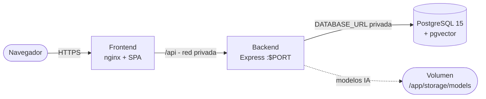

# Guía de despliegue en Railway — ContratoClaro

Guía operativa en español para desplegar los tres servicios (PostgreSQL,
backend y frontend) en Railway partiendo de cero. Verificada contra el código
real del repositorio (rama `main`); no inventa variables, rutas ni puertos.

> Estado: la aplicación corre y pasa todas las verificaciones locales
> (sección 11). Railway no está configurado todavía: los pasos 2-4 los
> ejecutas tú en el dashboard.

## 1. Arquitectura de despliegue



- **Frontend**: imagen `nginx:alpine` que sirve la SPA y redirige `/api/*`
  al backend por red privada. Sin `VITE_API_URL`: todo es mismo-origen,
  sin preflights CORS.
- **Backend**: imagen Node 22-slim (glibc, necesaria para onnxruntime),
  usuario `node` no-root, migraciones automáticas al arrancar
  (`npm run migrate:up && node dist/src/server.js`).
- **Base de datos**: PostgreSQL 15 con extensión `vector` (pgvector).
- **Una sola réplica** por servicio: la cola de análisis y la caché de IA
  viven en memoria del proceso y no se comparten.

## 2. Servicios a crear en Railway

En un proyecto nuevo, crea **tres servicios** desde el mismo repo GitHub
(`Jesusdavid2004/ContratoCeroO`, rama `main`):

| # | Servicio | Fuente | Directorio raíz | Detección |
|---|---|---|---|---|
| 1 | `db` (o `postgres`) | Add > Database > PostgreSQL | — | Imagen gestionada |
| 2 | `backend` | New Service > GitHub Repo | `/backend` | Dockerfile (auto) |
| 3 | `frontend` | New Service > GitHub Repo | `/frontend` | Dockerfile (auto) |

No se necesita `railway.toml`: los Dockerfiles del repo son la configuración.

## 3. Configuración exacta de cada servicio

### 3.1 Backend (`/backend`)

- **Root Directory:** `/backend`. **Builder:** Dockerfile.
- **Healthcheck Path:** `/ready` (responde 200 solo si PostgreSQL responde).
- **Replicas:** 1. No activar réplicas ni autoscaling.
- **Volumen:** crear uno montado en `/app/storage/models`. Sin él, cada
  despliegue re-descarga ~500 MB de modelos de IA en el primer análisis.
- **Start Command:** el del Dockerfile (`npm start`, que primero aplica
  migraciones). No sobrescribir.
- **Puerto:** Railway inyecta `PORT` automáticamente; el backend lo lee de
  `process.env.PORT`. No fijar ningún puerto manualmente.

### 3.2 Frontend (`/frontend`)

- **Root Directory:** `/frontend`. **Builder:** Dockerfile.
- **Healthcheck Path:** `/`.
- **Replicas:** 1.
- El contenedor genera su `nginx.conf` al arrancar desde variables de entorno
  (`frontend/docker-entrypoint.sh` + `frontend/nginx.conf.template`):
  escucha en `$PORT` y redirige `/api/*` a `$BACKEND_HOST:$BACKEND_PORT`.
- **Generar dominio público** (Networking > Generate Domain): obtendrás
  `https://<algo>.up.railway.app`. Esa URL va a `CORS_ORIGIN` del backend.

### 3.3 Base de datos

- Usar la **URL privada** (`...railway.internal`) para `DATABASE_URL` del
  backend: menos latencia y sin exposición pública.
- Las migraciones crean las tablas si no existen (`users`, `contracts`,
  `clauses`, `objection_letters`, `ai_usage`, `legal_provisions`) y la
  extensión `vector` (`CREATE EXTENSION IF NOT EXISTS vector`).
- Los volúmenes de Railway persisten los datos entre despliegues; no borrar
  el volumen salvo que se quiera empezar de cero.

## 4. Variables de entorno listas para copiar

### A. Backend (`backend` service)

```env
NODE_ENV=production
DATABASE_URL=<pegar URL privada de Postgres>
JWT_SECRET=<botón Generate: valor aleatorio>
CORS_ORIGIN=https://<tu-frontend>.up.railway.app
AI_PROVIDER=local
GEMINI_API_KEY=<opcional: tu key de AI Studio, habilita el tier híbrido>
RAG_ENABLED=false
CONTRACT_FILE_RETENTION=none
```

| Variable | Servicio | Obligatoria | Valor | Origen |
|---|---|---|---|---|
| `NODE_ENV` | backend | Sí | `production` | Fijo (activa trust proxy, cookies `Secure`/`SameSite=strict`) |
| `DATABASE_URL` | backend | Sí | URL privada de Postgres | Servicio `db` > Variables |
| `JWT_SECRET` | backend | Sí | Aleatorio ≥16 caracteres | Botón Generate de Railway |
| `CORS_ORIGIN` | backend | Sí | URL HTTPS exacta del frontend | Paso 6, sin `/` final |
| `AI_PROVIDER` | backend | No | `local` (por defecto) | Fijo |
| `GEMINI_API_KEY` | backend | No | Key de AI Studio | [AI Studio](https://aistudio.google.com/apikey), gratis |
| `RAG_ENABLED` | backend | No | `false` | Fijo hasta revisar el corpus legal |
| `CONTRACT_FILE_RETENTION` | backend | No | `none` | Fijo (no hay object storage privado) |
| `EMBEDDING_CACHE_DIR` | backend | No | `/app/storage/models` | Fijo (coincide con el volumen) |
| `PORT` | backend | No (la inyecta Railway) | — | Automática |

Variables con valor por defecto en código que **no** hace falta definir:
`JWT_ACCESS_EXPIRES_IN` (15m), `JWT_REFRESH_EXPIRES_IN` (7d),
`ANALYSIS_JOB_TIMEOUT_MS` (600000), `DAILY_AI_QUOTA` (20),
`GRPC_PORT` (50051, el servidor gRPC no se inicia en producción),
`GRPC_INTERNAL_TOKEN`, `SEED_DEMO` (nunca `true` en producción),
`ANTHROPIC_API_KEY`/`AI_MODEL_FAST`/`AI_MODEL_SMART` (eliminadas del código).

### B. Frontend (`frontend` service)

```env
BACKEND_HOST=${{backend.RAILWAY_PRIVATE_DOMAIN}}
BACKEND_PORT=${{backend.PORT}}
```

| Variable | Servicio | Obligatoria | Valor | Origen |
|---|---|---|---|---|
| `BACKEND_HOST` | frontend | Sí | `${{backend.RAILWAY_PRIVATE_DOMAIN}}` | Referencia Railway (ajusta `backend` al nombre real del servicio) |
| `BACKEND_PORT` | frontend | Sí | `${{backend.PORT}}` | Referencia Railway (puerto dinámico del backend) |
| `PORT` | frontend | No (la inyecta Railway) | — | Automática |

No definir `VITE_API_URL`: el frontend usa rutas relativas y Nginx
redirige `/api/*` al backend por red privada.

### C. Base de datos (`db` service)

Sin variables manuales: Railway genera usuario, contraseña y
`DATABASE_URL`. Solo se consume su `DATABASE_URL` privada desde el backend.

## 5. PostgreSQL y pgvector

- Las migraciones (`backend/migrations/`, aplicadas solas al arrancar)
  ejecutan `CREATE EXTENSION IF NOT EXISTS vector` y crean las 6 tablas.
- **Compatibilidad Railway:** no se pudo verificar el catálogo de
  extensiones del Postgres gestionado de Railway desde aquí. Procedimiento:
  despliega y observa los logs del backend en el primer arranque.
  - Si ves `Migrations complete!` y `/ready` responde 200 → compatible.
  - Si falla con `extension "vector" does not exist` → crea un proyecto
    **Neon** gratuito (PostgreSQL 15+, la guía de `docs/deployment.md`
    lo detalla) y usa su URL directa (`sslmode=require`) en
    `DATABASE_URL`. El backend acepta `DATABASE_URL` o el grupo
    `DB_HOST/DB_PORT/DB_USER/DB_PASSWORD/DB_NAME`.

## 6. Volúmenes

| Servicio | Ruta de montaje | Contenido | Obligatorio |
|---|---|---|---|
| backend | `/app/storage/models` | Modelos e5-small + TrOCR (~500 MB) | Recomendado (evita re-descargas) |
| db | (gestionado por Railway) | Datos PostgreSQL | Sí (por defecto) |

Con `CONTRACT_FILE_RETENTION=none` los contratos originales nunca tocan
disco (solo memoria durante el análisis), así que no hace falta volumen
para `storage/contracts`.

## 7. Dominios públicos y privados

- **Público (navegador):** solo el frontend (`https://<app>.up.railway.app`,
  generado en Networking). El backend y la base de datos **no** llevan
  dominio público.
- **Privados (entre servicios):** backend → `<backend>.railway.internal`;
  el frontend los usa vía `BACKEND_HOST`/`BACKEND_PORT`.
- **CORS:** el backend solo acepta el origen exacto de `CORS_ORIGIN` con
  credenciales. Sin esto, el login falla aunque todo lo demás funcione.

## 8. Conexión frontend ↔ backend

Nginx sirve la SPA y redirige solo `/api/*` al backend interno; el navegador
nunca habla directo con el backend. Verificación:

```text
GET https://<frontend>/            -> 200 (HTML de la SPA)
GET https://<frontend>/api/ready  -> 200 {"status":"ready"} (vía proxy)
```

## 9. Orden correcto de despliegue

1. Crear proyecto + servicio **db**. Copiar su `DATABASE_URL` privada.
2. Crear servicio **backend** con las variables de §4.A (usa un
   `CORS_ORIGIN` temporal, se corrige en el paso 4).
3. Crear servicio **frontend** con las variables de §4.B. Generar su
   dominio público.
4. Volver al backend: fijar `CORS_ORIGIN` a la URL pública exacta del
   frontend y redeplear.
5. Verificar `/health` y `/api/ready` (sección 10).
6. En la web, **registrar un usuario nuevo** (el seed de demo está
   bloqueado en producción por diseño) y probar el flujo completo.

## 10. Verificación de funcionamiento

1. `GET https://<backend>/health` → `{"status":"ok"}`.
2. `GET https://<backend>/ready` → `{"status":"ready","provider":"local"}`
   (o `"local+gemini"` si configuraste la key).
3. Abrir el frontend, registrarse, subir un PDF con texto, esperar a READY,
   generar la carta, descargar el PDF, borrar el contrato y la cuenta.
4. La primera subida tarda minutos (descarga de modelos); las siguientes,
   segundos. Si un despliegue reinicia el análisis, el contrato pasa a
   FAILED con mensaje traducido en lugar de quedarse colgado.

## 11. Solución de errores frecuentes

| Síntoma | Causa probable | Arreglo |
|---|---|---|
| Migración falla: `extension "vector" does not exist` | Postgres sin pgvector | Usar Neon para la DB (sección 5) |
| Login falla con error de red/CORS | `CORS_ORIGIN` no es exactamente la URL pública | Corregir y redeplear backend |
| `413` al subir PDFs grandes | Límite de Nginx | Ya corregido en la plantilla (`client_max_body_size 12m`) |
| Análisis eternamente en curso | En el primer análisis se descargan ~500 MB | Esperar; verificar volumen en `/app/storage/models` |
| `/ready` responde 503 | DB inaccesible | Revisar `DATABASE_URL` privada y que `db` esté sano |
| `errors.analysis_interrupted` tras un redeploy | Normal: recuperación de jobs interrumpidos | Volver a subir el contrato |
| Frontend muestra la API de `localhost` | Caché vieja o `VITE_API_URL` definido | Quitar `VITE_API_URL`; redeplear frontend |

## 12. Procedimiento para actualizar la aplicación

1. `git pull origin main` en local y verificar `npm run type-check`, `npm test`,
   `npm run build` (backend) y `lint`, `type-check`, `test`, `i18n:check`,
   `build`, `test:e2e` (frontend).
2. `git push origin main`: Railway redespliega automáticamente ambos
   servicios (si está conectado el repo).
3. Las migraciones corren solas al arrancar el backend. **Backup antes de
   cualquier cambio de esquema.**
4. Verificar `/ready` y repetir el smoke test de la sección 10.
5. Mantener siempre **1 réplica** por servicio.

## Apéndice: qué se verificó localmente antes de esta guía

- `backend`: `tsc`, `vitest` (120 tests), `vite build` equivalente (`tsc -p tsconfig.build.json`).
- `frontend`: `tsc`, `vitest` (12 tests), `oxlint`, `i18n:check` (127 keys), `vite build`, Playwright (5 e2e con mocks + 1 contra backend real con FakeAI).
- Docker: `docker compose config` válido, ambas imágenes construyen, stack
  `db`/`backend`/`frontend` en `healthy`.
- Migraciones aplicadas al arrancar; seed demo con `SEED_DEMO=true`.
- API real: register → upload PDF → `READY` → carta `201` → PDF `200` →
  borrado de contrato y de cuenta `200`. Frontend servido por Nginx con
  proxy `/api` verificado (200 en `/` y en `/api/ready`).
- axe-core: 0 violaciones serias/críticas (12 combinaciones página/tema);
  Lighthouse desktop en `docs/quality/`.
